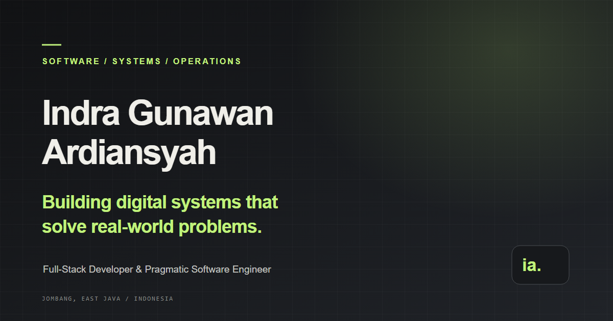

# Indra Gunawan Ardiansyah — Portfolio

A lightweight portfolio for **Indra Gunawan Ardiansyah**, Full-Stack Developer and Pragmatic Software Engineer. The site brings together software development, system architecture, and practical operational experience without overstating project status or professional claims.



> **Website status:** This repository contains the portfolio source. No live website or deployment has been verified or configured.

## Contents

- [Highlights](#highlights)
- [Technology](#technology)
- [Project structure](#project-structure)
- [Run locally](#run-locally)
- [Validate](#validate)
- [Production and deployment](#production-and-deployment)
- [Performance, accessibility, and security](#performance-accessibility-and-security)
- [Environment variables](#environment-variables)
- [License](#license)
- [Author and contact](#author-and-contact)

## Highlights

- Responsive single-page portfolio with sections for experience, skills, projects, architecture, engineering philosophy, education, and contact.
- Dark and light themes with a saved preference when browser storage is available.
- Keyboard-friendly mobile navigation and project-status filters.
- Clearly separated public source repositories, operational experience, and unverified or future concepts.
- No framework, external font, runtime API, tracking, fake contact form, or third-party JavaScript dependency.
- Search metadata, Open Graph information, a custom social-preview graphic, and an SVG favicon.

## Technology

- Semantic HTML
- CSS with custom properties and responsive layouts
- Vanilla JavaScript for theme, mobile navigation, project filters, active-section indication, and back-to-top control
- Python 3 standard library for the optional local preview and repository validation script

There is no package manager, package manifest, compilation step, or build dependency.

## Project structure

```text
.
├── site/
│   ├── assets/
│   │   ├── favicon.svg
│   │   └── social-preview.svg
│   ├── index.html
│   ├── script.js
│   └── styles.css
├── docs/
│   ├── ARCHITECTURE.md
│   └── REPOSITORY-AUDIT.md
├── scripts/
│   └── validate_site.py
├── CHANGELOG.md
├── Documentation.md
└── README.md
```

Existing profile assets at the repository root are retained and are not required to run the site.

## Run locally

Install no packages. From the repository root, start Python's built-in static server:

```powershell
python --version
python -m http.server 4173 --directory site
```

Open `http://localhost:4173` in a browser. Stop the server with `Ctrl+C`.

Alternatively, open `site/index.html` directly; a local server is closer to the eventual hosted environment.

## Validate

Run the dependency-free structural and local-link checks:

```powershell
python scripts/validate_site.py
```

The script validates local asset paths, in-page anchors, external-link protections, required sections and metadata, theme/filter hooks, and project-card counts. It does not replace browser, assistive-technology, or performance testing.

## Production and deployment

There is no generated build output: `site/` is the production-ready static source. The build step is therefore **none**. For a static host, publish the contents of `site/` as the document root.

GitHub Pages is **not configured or enabled**. The project has no deployment workflow and no verified production URL or canonical domain. To use GitHub Pages, first choose the desired URL and publishing strategy; then explicitly configure a workflow that uploads `site/` as its Pages artifact (or use a supported branch directory containing the site files). Check the generated URL and metadata before sharing it. Do not treat a repository path or the Open Graph image's raw-source URL as a live website.

No deployment has been performed.

## Performance, accessibility, and security

- The page ships without third-party scripts, runtime requests, downloaded fonts, or framework dependencies.
- System font stacks and CSS/SVG illustrations avoid external asset requests.
- Responsive layout, visible keyboard focus, a skip link, semantic landmarks, reduced-motion support, and keyboard-operable controls are included.
- Theme preference is stored locally only; if storage is unavailable, the theme still works for the current page view.
- External repository/profile links use `rel="noopener noreferrer"` with new browsing contexts.
- No credentials, API secrets, contact-form data, or analytics are used.
- Lighthouse/Core Web Vitals have not been measured in a browser for this change; no scores or production performance claims are made.

See [the repository audit](docs/REPOSITORY-AUDIT.md) and [technical documentation](Documentation.md) for scope and known limitations.

## Environment variables

None. The website is static and contains no server-side configuration.

## License

No repository-wide license file is present. Do not assume that the site, existing assets, or linked project repositories are licensed for unrestricted reuse. In particular, the SiMadik repository has its own custom restrictive license; see its [source repository](https://github.com/irwansyah1998/SiMadik) for current terms.

## Author and contact

**Indra Gunawan Ardiansyah**\
[GitHub: irwansyah1998](https://github.com/irwansyah1998) · [Email: nigun1998@gmail.com](mailto:nigun1998@gmail.com)

Projects referenced in this portfolio: [TugasAkhir](https://github.com/irwansyah1998/TugasAkhir) and [SiMadik](https://github.com/irwansyah1998/SiMadik). Source availability does not imply a deployed demo.
